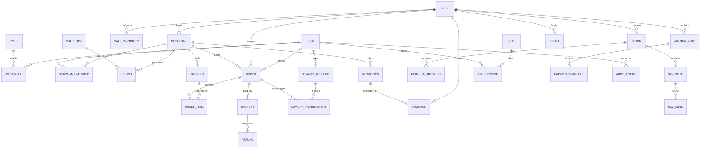

# Core Data Model and ERD

This is a logical model. Field types, constraints, indexes, retention, and migration details must be finalized during implementation. Use UUID primary keys and UTC timestamps unless a specific integration requires otherwise.

## Entity definitions

### Identity and tenancy
- **User:** id, display_name, email/phone (verified flags), status, created_at, deleted_at.
- **Role:** id, code (`VISITOR`, `MERCHANT_OWNER`, `MERCHANT_MANAGER`, `MERCHANT_STAFF`, `MALL_ADMIN`, `PLATFORM_ADMIN`, optional `SUPPORT`, `FINANCE`).
- **UserRole:** user_id, role_id, optional mall_id and merchant_id scope. Prefer scoped memberships over global role assumptions.
- **Mall:** id, slug, name, address, timezone, currency, status, logo/media references.
- **MallCapability:** id, mall_id, capability_key, status, config JSON, config_version, updated_by, updated_at.

### Merchants and catalog
- **Merchant:** id, mall_id, legal/display name, category, status, location/floor reference, hours, contact, approval metadata.
- **MerchantMember:** merchant_id, user_id, role, status, invited_by, joined_at.
- **Category:** id, mall_id nullable for global taxonomy, parent_id, name, slug, sort_order, active.
- **Listing:** id, merchant_id, category_id, title/description, tags, visibility status.
- **Product/MenuItem:** id, merchant_id, type, name, description, price_minor_units, currency, availability status, tax category, image references. Keep prices in integer minor units, not floating point.
- **Promotion:** id, merchant_id, type, terms, starts_at, ends_at, status, eligibility config, stacking policy, approval metadata.
- **Campaign:** id, mall_id, merchant_id, placement, starts_at, ends_at, budget/limit, status, approval, billing reference, measurement definitions.

### Commerce
- **Order:** id, user_id, mall_id, merchant_id, status, currency, subtotal_minor, discount_minor, tax_minor, fees_minor, total_minor, idempotency_key, fulfillment_type, timestamps.
- **OrderItem:** id, order_id, product_id nullable snapshot reference, item_name_snapshot, quantity, unit_price_minor, discount_minor, tax_minor, line_total_minor, customization snapshot.
- **Payment:** id, order_id, provider, provider_reference, amount_minor, currency, status, idempotency_key, confirmed_at.
- **Refund:** id, payment_id, amount_minor, reason, status, provider_reference, requested_by, completed_at.
- **Settlement:** optional ledger for merchant payout allocation, commissions, provider fees, adjustments, and payout references. Required if the platform handles merchant funds or settlements.

### Loyalty
- **LoyaltyAccount:** id, user_id, scope_type (`PLATFORM`, `MALL`, `MERCHANT`), scope_id nullable, currency/points policy reference, status.
- **LoyaltyTransaction:** id, account_id, type, points_delta, status, order_id nullable, reward_id nullable, expires_at nullable, reverses_transaction_id nullable, idempotency_key, created_at.
- Store derived balance as a cache only; ledger remains authoritative.

### Facilities and maps
- **Floor:** id, mall_id, label, level_order, map_asset_version, published_at.
- **PointOfInterest:** id, mall_id, floor_id, merchant_id nullable, type, label, map_x, map_y, status.
- **NavNode:** id, mall_id, floor_id, x, y, node_type, accessibility attributes.
- **NavEdge:** id, from_node_id, to_node_id, distance, route attributes, accessible, status.
- **Seat:** id, mall_id, food_court_id/zone_id, label, seat_type, QR identifier/hash, status.
- **SeatSession:** id, seat_id, user_id nullable, status, started_at, expires_at, ended_at, end_reason, idempotency_key.
- **ParkingZone:** id, mall_id, external_zone_id, display_name, integration_id, status.
- **ParkingSnapshot:** id, parking_zone_id, available_count nullable, occupied_count nullable, source_timestamp, received_at, data_quality_status.
- **Event:** id, mall_id, title, description, starts_at, ends_at, location reference, status, organizer, registration_url nullable.

### Operations
- **NotificationPreference:** user_id, channel, category, enabled.
- **AuditEvent:** id, actor_user_id nullable, tenant scope, action, resource_type, resource_id, safe metadata, request_id, created_at.
- **Integration:** id, mall_id nullable, type, provider, status, secret reference (never secret value), last_success_at, health metadata.

## Data rules
- Use foreign keys and database constraints for invariants.
- Index tenant scope columns and common query patterns.
- Use soft deletion only where justified; financial records must remain auditable.
- Snapshot item names/prices/terms into orders so later catalog changes do not rewrite history.
- Use integer minor currency units and explicit currency codes.
- Avoid storing precise location history unless there is a defined, consented need.
