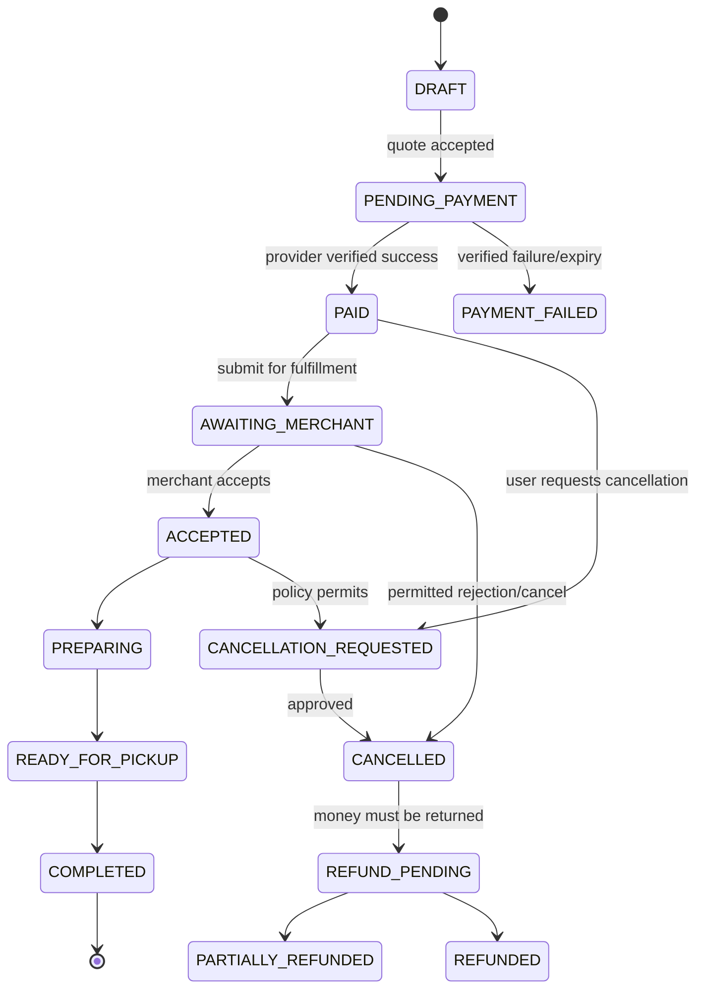

# Orders, Payments, Refunds, and Loyalty Workflows

## 1. Order state model

This diagram is a starting model. Exact valid transitions depend on fulfillment, provider behavior, and merchant policy. A completed order may also receive a post-completion partial refund through a separately permitted workflow.

## 2. Payment sequence
1. Client requests a server-side quote.
2. Server loads current product prices, availability, tax/fee rules, promotion eligibility, and mall/merchant capabilities.
3. Client confirms the quote before expiry.
4. Server creates an order with a unique idempotency key.
5. Server creates provider payment intent/session.
6. Client completes provider-controlled payment flow.
7. Provider sends a signed callback/webhook.
8. Server verifies signature, event identity, amount, currency, and provider reference.
9. Server applies the event once, records payment state, and advances the order only through allowed transitions.
10. Client polls/subscribes for server-confirmed status.
11. Reconciliation jobs compare provider and internal records.

Do not mark an order paid based solely on a redirect or mobile callback.

## 3. Idempotency
- Persist idempotency key and request fingerprint.
- Repeated same-key/same-request returns original result.
- Same key with materially different payload returns a conflict.
- Webhook event IDs must be deduplicated.
- Loyalty award/reversal uses a stable unique reference such as order + event type + policy version.
- Do not use retries that can repeat financial side effects without idempotency.

## 4. Financial records
Use integer minor units plus explicit currency. Store immutable order-item snapshots. Record gross, discounts, taxes, fees, refunds, provider fees, platform commission, and settlement allocation distinctly. Never silently overwrite historic values when merchant prices or campaign terms change.

## 5. Loyalty state and example policy
Potential lifecycle:
- `PENDING`: qualifying order has not yet reached award event.
- `AVAILABLE`: points are redeemable.
- `REDEEMED`: points spent.
- `EXPIRED`: points expired under published policy.
- `REVERSED`: original earning was reversed after cancellation/refund.
- `ADJUSTED`: audited support/finance correction.

Example only: points awarded after completed order; refund reverses points proportional to the eligible refunded amount; if points were already spent, policy may allow a negative available balance or block future earning until reconciled. The business must select and publish one policy before launch.

## 6. Loyalty ledger invariants
- Append a transaction; do not mutate historical transactions to hide activity.
- Use reversal references.
- Check available balance and redemption eligibility in one atomic transaction.
- Lock or otherwise safely serialize concurrent redemptions.
- Redemption must be idempotent.
- Display expiry and restrictions clearly.
- Define how partial refunds, taxes, discounts, fees, and merchant-funded rewards affect points.

## 7. Merchant settlement
If the platform collects customer funds and remits to merchants, define whether it acts as marketplace/payment facilitator and confirm provider/legal requirements. Settlement ledger should record order amount, refunds, provider fees, platform fee, taxes/adjustments, merchant payable, payout reference, and reconciliation status. Do not infer settlement from an order's `COMPLETED` state.
