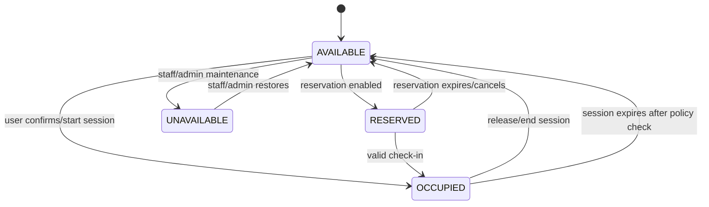

# Seat Sessions, Parking, and Indoor Navigation

## 1. Seat-session lifecycle

The system should retain session history separately from the current seat state. Expiry must not blindly free a seat if the business process requires staff review. QR scan alone does not establish physical occupancy.

### QR security
- Use opaque random IDs or revocable tokens.
- Do not put user data or predictable sequential IDs in QR content.
- Validate token status server-side.
- Apply rate limits.
- Allow rotation/revocation for compromised codes.
- Associate every QR with the correct mall/food-court/seat.
- Log staff overrides.
- Prevent overlapping active sessions unless multi-seat rules explicitly allow them.

## 2. Parking data
Normalize provider data into a snapshot:
- mall ID, zone ID, provider timestamp, received timestamp, available count, occupied count, quality status.
- Keep raw provider payload only if needed and safely retained.
- Deduplicate repeated events.
- Detect stale timestamps, impossible counts, negative values, and integration outages.
- Mark data `STALE` or `UNAVAILABLE` rather than displaying false precision.
- Define freshness thresholds per provider; do not hardcode one universal threshold.

Parking availability does not mean the user has a reserved space. Reservation, payment, entry control, and vehicle location are separate capabilities.

## 3. Indoor navigation data
Represent walkable space as a graph:
- nodes: entrances, junctions, destinations, elevators, escalators, stairs, accessible transitions.
- edges: traversable connections with distance and attributes.
- points of interest: shops, restaurants, amenities.
- each node/POI belongs to a mall and floor coordinate system.

Route calculation:
1. Validate published graph version.
2. Resolve start and destination nodes.
3. Apply constraints (e.g. accessible route).
4. Compute path.
5. Include floor transition instructions.
6. Return route with map version and instructions.
7. Fail gracefully if graph disconnected or stale.

If indoor positioning is unavailable, user selects start point or scans a known checkpoint. Do not label a manually selected location as live GPS location.

## 4. Publication checks
Before publishing a map:
- all POIs reference a valid mall/floor;
- route graph has no invalid references;
- intended entrances and destinations are connected;
- floor transitions have valid endpoints;
- accessibility attributes are reviewed;
- a human tester verifies representative routes on-site.
